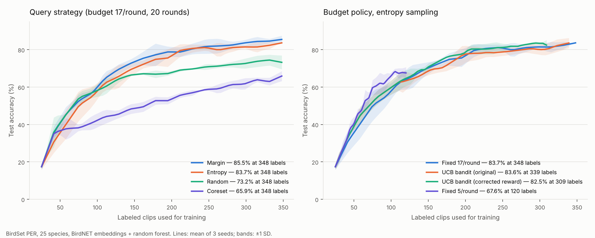

# Adaptive-Budget Active Learning for Bird Sound Classification

My part of an active learning project at **UCSD Engineers for Exploration (E4E)**, done in collaboration with the **San Diego Zoo**. The team project trains bird-species classifiers on audio embeddings while asking a human to label as few clips as possible. My work focused on **how many** clips to label each round and **which** clips to pick, plus making sure the evaluation measures what we think it measures.

> This repo contains only my own code and results tables. The full team pipeline lives in a private UCSD-E4E repository. No lab audio or embeddings are included.



## The problem

Labeling bird audio takes expert time. Active learning (AL) trains a model on a small labeled set, uses it to choose the most informative unlabeled clips, has those labeled, and repeats. Two choices drive how efficient this is:

1. **Query strategy:** which clips to ask about (e.g. the ones the model is least sure of).
2. **Budget per round:** how many clips to ask about at once. Small batches give more frequent feedback; large batches need fewer rounds.

## How the loop works

```
            ┌─────────────────────────────────────────────────────┐
            ▼                                                     │
  train model on labeled clips ─► evaluate (val + test)           │
            │                                                     │
            ▼                                                     │
  bandit picks budget b ∈ {5, 11, 17, 23, 30}                     │
  (rewarded by validation-accuracy gain per label of LAST batch)  │
            │                                                     │
            ▼                                                     │
  strategy picks b clips (entropy / margin / Top-K entropy …)     │
            │                                                     │
            ▼                                                     │
  "oracle" labels them ─► add to labeled set ─────────────────────┘
```

Clips are represented by pretrained **BirdNET** embeddings, and the classifier is a **random forest** head.

## My contributions

| Component | File | What it does |
|---|---|---|
| **Bandit budget agent** | [`adaptive_al/bandit_budget.py`](adaptive_al/bandit_budget.py) | Multi-armed bandit over budget sizes. Epsilon-greedy with decay and optimistic initialisation, or UCB. Reward = accuracy gain per label spent. |
| **Top-K Entropy strategy** | [`adaptive_al/top_k_entropy.py`](adaptive_al/top_k_entropy.py) | Recording-aware uncertainty sampling: scores each recording by the mean entropy of its top-K clips and takes one clip per recording, so the budget isn't spent on near-duplicate clips. Based on Martinsson et al. (2025). |
| **Recording-based split** | [`adaptive_al/recording_split.py`](adaptive_al/recording_split.py) | Splits train/test by whole recordings so clips sharing background noise never land on both sides. |
| **Query-by-Committee (MC Dropout)** | [`adaptive_al/qbc.py`](adaptive_al/qbc.py) | Approximates a committee with repeated dropout-on forward passes and picks the clips with the highest disagreement. Needs an MC-Dropout model (the team's MLP head). |
| **Dynamic batch size** | [`adaptive_al/dynamic_budget.py`](adaptive_al/dynamic_budget.py) | Rule-based alternative to the bandit: budget = number of clips above an entropy threshold (inspired by Adachi et al., 2024). |
| **Label regeneration utility** | [`scripts/regenerate_labels.py`](scripts/regenerate_labels.py) | Rebuilds `labels.csv` with recording IDs from BirdSet metadata without re-downloading audio. |
| **Pipeline integration and experiments** | (team repo) | Integrated the bandit into the team's experiment runner, built the BirdSet PER/UHH configs, scaled experiments to 2,000 clips / 25 species, and ran the strategy, budget and initial-pool studies below. |

[`adaptive_al/loop.py`](adaptive_al/loop.py) is a small standalone re-implementation of the AL loop, written for this repo so the components run without the private pipeline.

## Results (BirdSet PER, 25 species)

Setup: 2,000 clips from the public [BirdSet](https://huggingface.co/datasets/DBD-research-group/BirdSet) PER subset, BirdNET embeddings, random forest head, 25 initial labels, 20 rounds. **Every number is the mean of 3 seeds.** Re-run in October 2026 (see [notes](docs/rerun_notes.md)).

**Query strategy** (fixed 17 clips/round, 348 labels at the end):

| Strategy | Final accuracy |
|---|---|
| Margin | **85.5 ± 2.0%** |
| Entropy | 83.7 ± 0.4% |
| Least confidence | 83.6 ± 1.5% |
| Random | 73.2 ± 3.7% |
| Coreset | 65.9 ± 2.6% |

Uncertainty-based strategies beat random sampling by **10–12 points** at the same labeling cost. Coreset (diversity-only) did worse than random on these embeddings.

**Budget policy** (entropy sampling, accuracy at a matched number of labels):

| Policy | @100 labels | @200 labels | @300 labels |
|---|---|---|---|
| Fixed 5 / round | **66.0%** | n/a | n/a |
| Fixed 17 / round | 57.9% | 76.8% | 81.5% |
| UCB bandit | 59.8% | 78.8% | 83.4% |

Smaller batches are the most label-efficient early on, and the epsilon-greedy bandit learned to prefer the smallest budget by itself. At matched label counts, the UCB bandit is **within noise** of a well-chosen fixed budget. It's a reasonable default when you don't know the best batch size in advance, not a clear accuracy win.

**Initial pool size** (margin): 100 initial labels → 85.4 ± 0.7%, 10 initial labels → 82.6 ± 2.9%. That's a small effect relative to seed variance.

All per-condition numbers: [`results/summary.csv`](results/summary.csv) and [`results/accuracy_at_matched_labels.csv`](results/accuracy_at_matched_labels.csv). Raw per-round curves: [`results/runs.json`](results/runs.json).

### What I learned (honest notes)

- **Compare at equal labeling cost.** An early version of my results compared a 20-round bandit run against an 8-round fixed run, which made the bandit look 13 points better. At matched label counts the gap disappears.
- **Reward scale matters for UCB.** Raw rewards (~0.003 accuracy per label) were tiny next to UCB's exploration bonus (~1), so the original agent just cycled through the arms. Scaling the reward and crediting each arm with the gain of *its own* batch, measured on validation rather than test data, fixed this.
- **Check that your safeguard has something to guard.** In our PER sample every clip comes from a different recording, so the recording split and Top-K Entropy reduce to their plain versions there. The [demo](#run-the-demo) uses multi-clip recordings to show where they matter: a clip-level split scores **~99%** vs **~84–86%** for a recording split on the same data.
- **Seeds and versions matter.** The same config gave results about 4 points apart across scikit-learn versions, so I report means over seeds and pin versions.

## Run the demo

The demo uses synthetic embeddings with a recording structure (species signal + per-recording "background" + clip noise), so it runs anywhere in 1–2 minutes.

```bash
git clone https://github.com/laura06919-max/adaptive-budget-active-learning.git
cd adaptive-budget-active-learning
python -m venv .venv && source .venv/bin/activate
pip install -r requirements.txt
python demo/run_demo.py --plot
```

It prints (1) clip-level vs recording-level split accuracy, (2) random / entropy / margin / Top-K entropy, and (3) fixed budgets vs the UCB bandit at matched label counts, each as mean ± SD over 5 seeds. With `--plot` it also saves `demo/demo_curves.png`.

The leakage gap in (1) is large and stable. Sections (2) and (3) are there to show the components working end to end; on this small synthetic set their differences are mostly within one SD and shift a little across machines, so the real-data results above are the ones to cite.

Use the bandit in your own loop:

```python
from adaptive_al import BanditBudgetAgent

agent = BanditBudgetAgent(min_budget=5, max_budget=30, n_arms=5, strategy="ucb", ucb_c=1.41)
budget, arm = agent.select_budget(round_idx)
# ... label `budget` clips, retrain, measure validation accuracy ...
agent.update(arm, reward=100 * (val_acc_new - val_acc_old) / budget)
```

## Repo structure

```
adaptive_al/           my components (bandit, Top-K entropy, recording split, QBC, dynamic budget)
  loop.py              standalone AL loop used by the demo
demo/run_demo.py       runnable synthetic-data demo
scripts/               label regeneration utility
results/               PER re-run: summary tables, per-round curves, plot + script
docs/                  team context and re-run methodology
```

## Tech stack

Python · NumPy · scikit-learn (random forest) · pandas · matplotlib · BirdNET embeddings · HuggingFace `datasets` (BirdSet) · PyTorch (MC-Dropout MLP in the team pipeline)

## Credits

- **Jeremy Frank** (project lead): pipeline architecture, preprocessing, CLI, mixed/ensemble strategies, GPU support.
- **Shrivas Sudharsan**: embedding pipelines (Perch, BirdNET), model heads, class-imbalance handling, analysis tooling. See his showcase repo: [active-learning-bioacoustics](https://github.com/shrivassudharsan1/active-learning-bioacoustics).
- **UCSD Engineers for Exploration** and the **San Diego Zoo** for the project and collaboration.
- Data: [BirdSet](https://huggingface.co/datasets/DBD-research-group/BirdSet) (DBD Research Group); recordings originally from Xeno-canto.
- References: Martinsson et al. (2025) on Top-K entropy for bioacoustic AL; Adachi et al., *Adaptive Batch Sizes for Active Learning*, AISTATS 2024.
